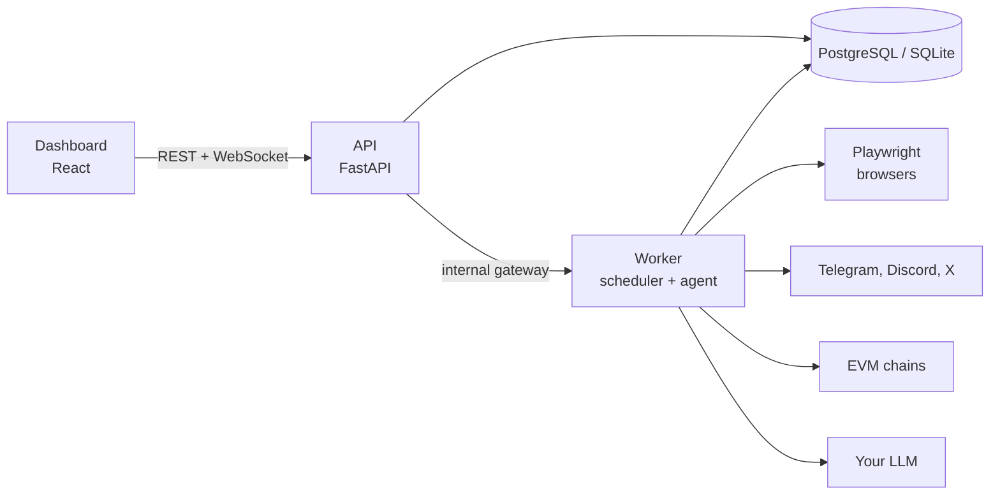

# AirdropOS

### Your autonomous AI agent for crypto airdrops.

**Research, execute and monitor airdrops 24/7. You stay in control of every transaction.**

  
  
  
  
  
  

[**Run it**](DEVELOPMENT.md) · [Features](#features) · [How it works](#how-it-works) · [Security](#security) · [Docs](#documentation)

---

## Run it

> **To run AirdropOS, follow [DEVELOPMENT.md](DEVELOPMENT.md).**
> Step-by-step guides for **Windows PowerShell**, **Windows CMD**, **Ubuntu** and **VPS (Docker)**:
> install, clone, `.env`, start, and update.

---

## Features

| | |
|---|---|
| 🤖 **Autonomous agent** | Observe → Plan → Act → Verify loop. A task is completed only with verified evidence. |
| 🔎 **Airdrop intelligence** | Discovers airdrops, tracks goals and tasks, checks claims, sends daily reports. |
| 🌐 **Browser automation** | Playwright browsers with saved profiles. Watch every session live and take over for a CAPTCHA or human check. |
| 💬 **Telegram, Discord, X** | Works through your own Telegram account, plus Discord and X integrations. |
| 👛 **Wallet vault** | Import or watch wallets. Keys are AES-256-GCM encrypted and never exposed. |
| ⛓️ **EVM transactions** | Validation, gas estimation, spend limits, daily cap, nonce management. Nothing is signed unless you enable it. |
| 🧠 **Memory and learning** | Knowledge graph, verified-facts memory, and a learning engine that improves from outcomes. |
| ⏱️ **24/7 scheduler** | Background worker for discovery, monitoring and claim checks. |
| 📊 **Web dashboard** | Overview, tasks, agent chat, wallets, live broadcast, browser profiles, Telegram and security settings. |

## How it works

One LLM, one API key, one model. No routing and no fallback model. The LLM plans, and fixed code does the rest.

## Security

- 🔐 Login on every API route, deny-by-default scopes
- 🚫 The LLM can never sign transactions. Tools go through a governed registry
- 🛑 Emergency stop, spend limits, rate limiting
- 🧼 Secret screening and audit logs with redaction
- 🔒 Wallet keys stay encrypted with your own `WALLET_VAULT_MASTER_KEY`

More: [SECURITY.md](SECURITY.md) · [Wallet security](docs/WALLET_SECURITY.md)

## Documentation

| | |
|---|---|
| [DEVELOPMENT.md](DEVELOPMENT.md) | Run and deploy guide |
| [Architecture](docs/ARCHITECTURE.md) | How the parts fit together |
| [Deployment](docs/DEPLOYMENT.md) | VPS, HTTPS, proxies |
| [Telegram](docs/TELEGRAM_SETUP.md) · [Discord](docs/DISCORD_SETUP.md) · [X](docs/X_INTEGRATION.md) | Integration setup |
| [Browser Profiles](docs/BROWSER_PROFILES.md) | Persistent Chrome profiles, extensions, browser tools |
| [Live Broadcast](docs/LIVE_BROADCAST.md) | Watch and control browser sessions |
| [Troubleshooting](docs/TROUBLESHOOTING.md) | Common problems |
| [Changelog](CHANGELOG.md) | What changed |

## Contributing

Fork, create a branch, make your change, run `python -m pytest backend/tests/ -q`, open a Pull Request.
Changes must keep the security rules above.

> ⚠️ AirdropOS automates real accounts and can handle real funds. Use separate accounts and wallets, set low spend limits, and test on a testnet first.
